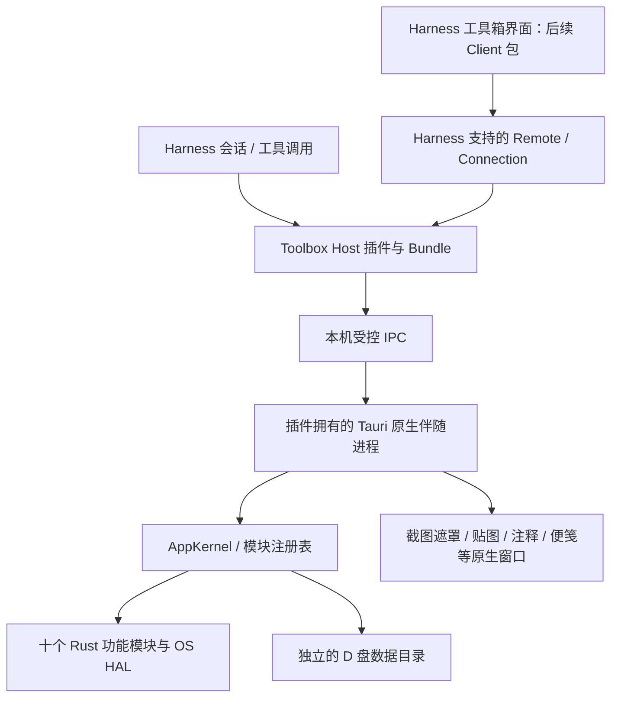

# YourAllIn1Helper → DeepSeek Harness 插件迁移计划

日期：2026-11-12。状态：可进入实施准备；本次仅完成规划。

工作区：`D:\Code\dsh-toolbox`。源码和环境事实见 [勘察基线](BASELINE.zh-CN.md)。

## 1. 迁移目标与首版范围

把现有工具箱变成可通过 Harness 安装、配置、调用和卸载的长期插件，保留成熟的 Rust 模块和原生桌面体验。默认目标为 **Windows x64、本机运行的 Harness**；macOS 兼容作为后续阶段，云端 Harness 控制本机桌面不在首版范围。

用户最终应当能够：

- 在会话中说“把这些图片转换成 WebP”“创建一个明天会议的便笺”，看到结果、文件入口及明确的失败原因。
- 在工具箱入口查看模块状态、外部依赖和设置，按需启动截图、屏幕注释、贴图等原生交互。
- 取消正在运行的任务；禁用模块后立即拒绝新操作；卸载后释放插件拥有的进程、快捷键、监听器及窗口。
- 在 D 盘完成开发、测试和打包，通过预构建包安装，无需使用者先安装 Rust。

**首个可试用版本（MVP）**只做状态/依赖探测、便笺创建与查询、图片转换，以及可靠的任务取消和卸载。便笺 CRUD 与桌面窗口打开分开验收。FFmpeg 音视频、截图/OCR、文本翻译随后接入；十个模块全部纳入路线图，不用空壳入口表示功能已完成。

拟采用本地开发包名 `dsh-toolbox`；实际发布名及可用性在发布阶段确认。本计划不执行公开发布。

## 2. 关键架构决策

### 2.1 普通插件 + Bundle，复用 Rust 原生宿主

采用可安装的普通 Cordis 插件和 Bundle，不把长期功能建立在临时 `cordis_define/run` 包上。后者不提供所需的安装、版本交付和重启恢复基础。[指南：动态插件边界](https://github.com/moneka123/deepseek-harness-plugin-dev-guide/blob/f224099dce05f47c931d5e70d09ace9627607401/DYNAMIC-PLUGINS.md)

现有 `app-core`、`os-hal` 和十个 `mod-*` 是复用主体。先保留 Tauri 宿主及原生界面，增加受控桥接模式；只抽取实现接入所必需的公共装配与路由，不预先重写整套应用。原项目主控台、脚本事件、凭据注入、截图二进制通道等仍有宿主耦合，不能把“模块已经拆 crate”理解成“零修改可嵌入”。



Host 插件负责模型工具、宿主策略、配置、任务与结果；原生进程负责业务执行和桌面资源。Client 只承担交互和展示，不直接访问 Node、文件系统或本地 IPC。

### 2.2 原生伴随进程的第一条实现路径

Windows 首选 **当前用户限定的 Named Pipe**，承载版本化、带长度边界的 JSON 请求/响应及事件。原生进程保留 Tauri 主事件循环，以支持窗口、系统回调和全局快捷键。具体命令行参数属于待实现的插件接口，不是现有 exe 已支持的参数。

- 由 Host 经目标 Harness 支持的子进程能力启动固定的随包 exe；核对策略后执行，不能假设普通 shell 沙箱允许所有桌面操作。
- 使用随机管道名、当前用户 ACL、拒绝远程客户端及启动实例握手；验证连接对应本次拥有的进程。不建立跨会话的通用“调用任意 IPC”服务。
- 一个运行实例拥有一个内核和一个数据目录；同一目录加独占锁。多个 Profile 的数据默认分开，争用桌面快捷键时明确报告冲突。
- 桥接启动模式默认不自动打开主控台、不启动原应用 updater，也不自动启用剪贴板采集或应用跟踪。模块按插件配置启用。
- 父进程退出、管道断开或心跳失联时进入停机流程；用 Job Object 或等效 Windows 机制兜底回收所属进程树。正常退出仍先保存并关闭资源。
- 不接管用户独立启动的旧工具箱进程，不终止其他应用。

M1 必须验证 release exe 的连接、启动握手、崩溃与关停。若 Named Pipe 所需宿主能力不可用，先记录阻碍并比较受控 stdio 适配；没有完成该验证就不扩展功能模块。

不直接启用现有 `legacy_http.rs` 作为发布桥。它是旧开发通道，存在按字符串分发 IPC、手写 HTTP 读取等实现；迁移只复用业务路由思想，新的桥有独立的版本、消息上限、调用白名单与取消协议。

### 2.3 Harness 扩展边界

优先独立函数插件、现有工具/任务/配置扩展点和后置 Patch；不修改 Harness 核心、Agent Loop 或内置 Bundle。普通发布入口为 ESM JavaScript。`name`、`apply`、`inject`、`Config` 等导出形式以实际 Loader 核对结果为准。[指南：开发规则](https://github.com/moneka123/deepseek-harness-plugin-dev-guide/blob/f224099dce05f47c931d5e70d09ace9627607401/AGENTS.md)

首版以工具及已有结果卡片为入口，同时能打开伴随进程中的设置页面。只有确认真实 Client 扩展点、构建 preset 和安装装配后，再增加 Harness 内工具箱页面。不能把 Vue 页面原样插入 Harness；先拆出传输适配、纯逻辑和可复用资源，再按宿主 UI 技术栈适配。

Host 与 Client 出现独立编译需求时拆包，共享协议保持浏览器可用。`window.__TAURI__`、Tauri 事件订阅、Win32 和凭据访问均留在各自适配器，不进入 Client bundle。[指南：扩展点参考](https://github.com/moneka123/deepseek-harness-plugin-dev-guide/blob/f224099dce05f47c931d5e70d09ace9627607401/REFERENCE.md)

## 3. 十个模块的迁移映射

以下为拟定迁移范围；“复用”表示代码基础存在，不代表新宿主下已验证。

| 模块 | 主要复用位置 | Harness 中的用途 | 原生与适配工作 | 阶段 |
| --- | --- | --- | --- | --- |
| 便笺 `sticky_note` | `mod-sticky-note`、`ipc/sticky_note.rs` | 创建、搜索、更新指定便笺 | CRUD 先接；窗口和退出冲刷后接；保留 Markdown/LaTeX 内容 | M2 / M3 |
| 多媒体 `media_proc` | `mod-media-proc`、`ipc/media.rs` | 图片转换；随后音视频处理与任务进度 | 输入输出授权、FFmpeg/FFprobe 探测、任务取消、产物展示 | M2 / M3 |
| 截图/贴图 `screenshot` | `mod-screenshot`、截图窗口与二进制通道 | 用户触发区域截图、OCR、贴图 | 复用原生遮罩；多屏/DPI/滚动/GIF 分项接入；图片走附件/受控产物通道 | M3 |
| 翻译 `translator` | `mod-translator`、`ipc/translator.rs` | 显式文本翻译；保留划词弹窗 | 文本调用先接；鼠标监听和选区提取后接；复用 provider 配置与凭据引用 | M3 |
| 屏幕注释 `screen_ink` | `mod-screen-ink`、`ink_window.rs` | 开关注释模式、打开工具栏、导出 | 继续使用原生全屏透明窗口；光标、穿透、结束清理需真机验证 | M3 |
| 窗口置顶 `window_pin` | `mod-window-pin`、OS HAL | 选择窗口后置顶/取消 | 句柄有效性、窗口归属及关闭处理；停机恢复原状态 | M3 |
| 剪贴板 `clipboard` | `mod-clipboard`、`clipboard_window.rs` | 用户开启后检索/选用指定历史条目 | 采集默认关闭；显式读取、敏感项过滤、粘贴目标与焦点验证 | M5 |
| 使用统计 `app_usage` | `mod-app-usage`、`ipc/usage.rs` | 用户开启后查询时长和汇总 | 不默认采集窗口标题；处理空闲/锁屏/睡眠；聚合展示 | M5 |
| 脚本 `script_runner` | `mod-script-runner`、宿主脚本适配器 | 选择已保存且允许的脚本执行 | 沿用宿主权限策略、解释器探测、最小环境、超时和进程树取消 | M5 |
| 密码本 `password_vault` | `mod-password-vault`、异步 vault IPC | 打开原生密码本、展示锁定/可用状态 | 保留用户手势与主密码解锁；密码、OTP 秘密和明文不进入模型工具结果 | M5 |

截图权限与图片回传、剪贴板内容、窗口标题、翻译到外部服务等数据流需要明确的用户操作和产品说明。密码本先提供 UI 入口，不设计模型读取任意密码的工具。脚本迁移也不向模型直接暴露旧通用 IPC 路由或任意 Shell 字符串。

## 4. 工具、协议和用户体验

### 4.1 首版拟定工具

| 拟定工具名 | 输入概念 | 输出概念 |
| --- | --- | --- |
| `toolbox_status` | 可选模块 | 模块状态、平台支持、缺失依赖、可恢复错误 |
| `toolbox_note_create` | 标题、正文、是否打开 | 便笺 ID、保存状态、打开状态 |
| `toolbox_note_search` | 搜索词、分页 | 匹配摘要与 ID；避免返回全部私人便笺 |
| `toolbox_note_update` | 指定 ID、修改内容、预期版本 | 更新结果或冲突 |
| `toolbox_image_convert` | 已授权输入文件、格式、输出位置 | 每个文件结果、产物引用、必要的 Job 标识 |

后续按需增加 `toolbox_capture`、`toolbox_translate` 等任务工具。具体注册名称与 Schema 在 M0 核对宿主后定稿，不承诺这些工具当前存在。开关、凭据输入和危险设置优先放用户设置界面，避免模型工具数量过多。

返回 JSON-safe 业务结果，错误通过宿主支持的错误契约传播，稳定区分取消、权限拒绝、模块禁用、缺少依赖、版本不匹配、文件冲突和执行失败。二进制图片/音视频不塞入巨型 JSON；由宿主支持的附件或产物接口返回，并单独限制大小、访问和保留期限。

### 4.2 受控桥协议

请求至少携带协议版本、请求 ID、明确方法、参数、超时预算；响应带结果或结构化错误。另有取消、ready、进度、完成及停机消息。Host 调用身份和本机授权状态由可信适配层传递，不接受模型自行声明身份或批准状态。

第一批只开放状态、便笺和图片转换方法。原生端同样校验方法、参数、启用状态和必要授权，始终经过模块注册表；不能因为请求来自管道就绕过 `with_enabled`。模型不能提交任意 `cmd` 来调用全部旧 IPC。

前台请求把 `exec.signal` 传播到桥、Rust 任务和外部程序；旧同步业务需要补取消点，不能只停止等待而让工作继续写文件。后台媒体任务接入宿主 Job 所有权，明确区分“取消此次等待”和“终止任务”。任务 ID、进度频率、并发上限和重复请求语义需有测试。

文件访问先经过 Harness 的文件/工作区策略，再向原生进程授予具体输入输出范围；处理符号链接、junction、路径规范化和覆盖确认。使用参数数组调用 FFmpeg 或解释器，不拼接 Shell。超时或重连后的不确定操作不盲目重试；写入操作使用幂等键或可查询状态。

### 4.3 原生与会话展示

首版展示每个功能的可用/启用/不支持/依赖缺失状态。启动失败要说明具体依赖或原生原因；缺 FFmpeg 不阻止便笺与图片功能启动。使用中文任务描述，错误提供可操作的下一步。

工具结果中被模型使用的事实通过宿主正常会话结果路径持久化。UI 卡片从可回放事件重建；插件私有数据库不等于会话日志。展示投影保持纯函数，页面通过受支持 Remote API 查询私有数据。对已过保留期的产物显示失效状态，不假定历史图片永久可访问。

## 5. 生命周期、配置与隔离

Host 的配置至少覆盖：`nativeExecutable`、`dataDir`、`artifactDir`、模块开关、超时、并发上限、产物保留、允许的文件根目录和外部程序路径。使用目标宿主支持的 Config Schema，启动前验证必填路径、跨字段约束及支持的桥版本。

运行时执行顺序：

1. 验证配置与二进制清单，取得数据目录锁，启动伴随进程。
2. 完成协议握手和能力探测后开放工具；未 ready 的调用明确等待或失败。
3. 进入卸载/重载：停止接受请求，取消或结束本插件拥有的任务。
4. 在一个有序异步清理流程中保存便笺、锁定密码本、还原置顶、关闭窗口、解除快捷键和监听器、关闭数据库。
5. 请求伴随进程退出并等待；超时才执行限定于本进程树的终止；最后释放 IPC、锁、订阅与临时产物。

以 `ctx.effect()` 绑定外部资源，显式等待异步工作停稳；不能假设多个 disposer 严格串行，也不能把移除 npm 包当作当前进程已经停机。重载失败的保留与恢复策略用实测定义，不承诺自动回滚。

默认每个开发/测试 Profile 独立数据目录，禁止双进程共享写入同一旧数据库。模块启用状态以原生内核为执行事实，Host/UI 同步展示；保存失败或启用失败不能显示成功。关键拒绝在真实执行路径落实，工具隐藏只用于发现和体验。

## 6. 工作区与 D 盘约束

### 6.1 目录约定

```text
D:\Code\dsh-toolbox\
├── README.md
├── docs\                         # 计划、基线、接口、测试/发布记录
│   └── references\               # 固定版本指南快照（已创建）
├── packages\
│   ├── dsh-toolbox\              # 首版 Host、工具与 Bundle
│   ├── dsh-toolbox-client\       # M3 按真实需要创建
│   └── contracts\                # 双端实际共享时再抽取
├── native\YourAllIn1Helper\      # 固定基线的原生源码副本
├── scripts\                      # 环境、构建、验收、打包脚本
├── vendor\harness\               # 仅在需要源码核对/构建时创建
├── build\rust\{target,intermediates}\
├── runtime\                      # 开发/验收 DSH_HOME、独立用户数据
├── artifacts\                    # 截图、媒体及验证证据
├── dist\                         # npm tgz、原生二进制、校验与清单
└── .tmp\                         # 本项目所有工具的临时目录
```

除文档外的上述目录均为拟建。原源码以固定 Git commit 的跟踪文件导出到 `native`，排除 `.git`、`.cargo` 本地配置、`node_modules`、运行数据、旧输出和目录链接；不递归照搬 C 盘工作树，也不沿 junction 复制旧构建目录。

### 6.2 构建进程环境

M0 创建项目级 PowerShell 启动脚本，只设置当前进程及子进程的环境，不改 Windows 全局设置：

| 设置/产物 | 约定 |
| --- | --- |
| CARGO_HOME / RUSTUP_HOME | 复用 `D:\Dev\Rust\cargo` 与 `D:\Dev\Rust\rustup` |
| Cargo target | `D:\Code\dsh-toolbox\build\rust\target` |
| Cargo build intermediates | `D:\Code\dsh-toolbox\build\rust\intermediates`，覆盖现有全局 `build-dir`；实际配置优先级在 M0 验证 |
| npm / pnpm 缓存 | 复用 `D:\cache\Node` 下的现有目录；各 pnpm 主版本确认实际 store 路径 |
| 新 pnpm 版本 | 实际 Harness 如要求 11.7.0，在 D 盘项目工具目录或现有版本管理区隔离使用，保留旧项目的 pnpm 10 |
| TEMP / TMP / TMPDIR | `D:\Code\dsh-toolbox\.tmp`，并传给全部构建、测试、打包子进程 |
| DSH_HOME | 开发与安装验收分别指向 `runtime\dsh-dev`、`runtime\dsh-acceptance` |
| 原生数据目录 | 显式传入 `runtime\toolbox\<profile>`；新增正式配置接口，不把 GUI 测试变量当成产品接口 |
| 前端输出、WebView 用户数据、下载 staging | 显式定位在工作区内；按实际宿主配置逐项核对 |
| 发布产物 | `dist\`；包内路径相对解析，不包含本机 `D:\...` 绝对路径 |

已安装 Node 位于 C 盘，可继续只读使用；系统 SDK、WebView2 和操作系统管理的凭据可能仍有系统目录活动。项目主动生成的构建、测试、缓存和包应定位到 D 盘，不声称整个操作系统会零写入 C 盘。

不能复制原 `.cargo/config.toml`：它会让新项目输出混入旧工具箱缓存。环境脚本同时检查 Cargo 全局 `build-dir`、前端 `outDir`、Tauri 输出和任何重解析点目标，确认所有项目产物落在本工作区。不要设置 `USERPROFILE`、`APPDATA` 或 `LOCALAPPDATA` 来强行重定位整个系统。

`D:\cache` 只作为共享缓存和既有工具来源，不在其中放本项目发布包，不整体清理。原项目、旧安装数据、现有 `.dsh` 及其他会话目录均不修改。

## 7. 数据迁移与兼容

MVP 先使用空白隔离数据，不自动打开原数据库。M4 制作显式导入向导和可演练的迁移流程：

1. 探测旧数据位置并由用户选择。默认 Tauri 数据在用户应用目录，但实际可能有自定义路径；不要把 C 盘源码目录当作用户数据库。
2. 正常退出旧应用以冲刷窗口数据；若支持在线备份，使用 SQLite backup 一致性接口，不能只复制处于 WAL 状态的 `app.db`。
3. 在工作区导入 staging 创建数据库、配置及关联文件的备份与清单，记录源版本、Schema、文件哈希和条目数。不输出私人内容。
4. 在目标副本执行原迁移链，检查便笺、剪贴板文件、脚本、媒体记录和窗口配置的引用；按记录来源规则处理已不存在的绝对路径。
5. 在新环境验证重启、查询、编辑及模块开关，再启用正式目标目录；失败时保留原件和错误报告。

密码本单列验收：密文数据库、设备密钥、`vault-hello` 文件及操作系统密钥标识可能分处不同位置；Windows Hello 不可导出密钥不能靠复制数据库迁移。先核对身份/slot/路径依赖，保留主密码恢复与重新绑定流程；不降低认证方式，也不让模型读取密钥。翻译 API Key 同样先验证凭据后端与标识，不能假定复制配置就能继续使用。

初期保留旧应用标识相关的凭据访问适配，但数据目录独立；任何标识变更须有迁移说明。导入后的数据版本不兼容旧版时，回退到导入前备份和旧应用，而非强行降级新数据库。卸载插件保留用户数据，删除数据必须是独立的明确操作。

## 8. 分阶段执行与交付门槛

估算按一位开发者连续推进、复用现有代码计算，单位为有效工作日；不包含等待真机人工验证的时间。MVP 约 **6–10 日**，十模块基础接入与 Windows 发布候选约 **18–31 日**。M0 后依据宿主接口可用性和窗口回归结果重估，不作为交付承诺。

| 阶段 | 时间 | 具体工作与交付物 | 进入下一阶段的门槛 |
| --- | --- | --- | --- |
| M0：宿主与环境基线 | 1–2 日 | 定位真实 Harness 安装/源码；记录版本；核对 tools、jobs、附件、Remote、Loader、CLI 与 peer；项目环境脚本、源码导出与锁文件策略 | 用实际目标宿主加载最小插件；路径审计证明构建/运行目录正确；明确目标 Profile 的 base/web-app 组合 |
| M1：桥与生命周期 | 2–3 日 | Tauri 桥接模式、固定协议、ready/status、实例/数据锁、取消和有序停机 | release exe 可运行；重复启动/重载无重复注册；父进程崩溃后无所属进程树残留；不自动采集私人数据 |
| M2：MVP 工具闭环 | 3–5 日 | 状态、便笺 CRUD、图片转换、标准结果卡片、产物引用；本地预构建 tgz | 干净 Profile 从 tgz 安装后完成真实任务、取消、重启和卸载；不依赖源码 tsx 或旁边原工程 |
| M3：桌面体验与实用能力 | 4–7 日 | 截图/OCR/贴图、屏幕注释、置顶、便笺窗口、文本/划词翻译、FFmpeg；可用时加入 Harness Client 页面 | 原生事件循环和 UI、焦点、多屏/DPI、快捷键冲突、工具卡片回放可验证；不支持的子能力明确显示 |
| M4：旧数据导入 | 3–5 日 | staging 导入、备份、Schema/文件引用核对、凭据与密码本迁移设计；失败恢复演练 | 在脱敏/生成夹具上导入成功；真实数据迁移有用户操作路径；旧应用和源数据保持可用 |
| M5：隐私及执行能力 | 3–5 日 | 剪贴板、使用统计、受控脚本、密码本 UI/状态入口；各自开关与授权 | 绕过 UI 的调用仍拒绝未授权操作；脚本进程树可取消；认证取消/失败无秘密泄漏；停用后停止采集 |
| M6：发布候选 | 2–4 日 | 包内容/哈希/许可证、兼容矩阵、安装升级卸载说明、干净环境端到端回归 | 从发布物完成安装→配置审计→启动→功能→升级→卸载；记录平台限制与所有未测项目 |

阶段顺序是依赖与风险顺序，不要求等 M5 才交付有用版本。M3 不覆盖的高级截图模式、macOS 和远程场景保持独立待办，逐项完成后再进入支持矩阵。

实施中维护逐项功能对等表，特别列出滚动截图、GIF、贴图操作、翻译服务、OTP、快捷键和设置。Windows 旧版功能需全部标明已迁移、保留原生入口、明确延期或不支持及其原因；只有完成约定的功能对等和真实数据验证，才建议替代旧应用。上述发布候选估时不等同于全功能对等的工期。

## 9. 测试与验收

实施时为每次验证记录执行目录、输入、命令、版本、结果及证据。下列是计划标准，本次没有运行这些测试。

| 层级 | 验证内容 | 可观察的通过标准 |
| --- | --- | --- |
| P0：加载与交付 | 类型检查、ESM 构建、普通 Node 加载、实际 Loader、tarball 内容 | JS/exports/Patch/原生 exe 齐全；不依赖未发布 TS 或本机绝对路径；Fiber 进入预期状态 |
| P0：执行边界 | 未启用模块、越界路径、未经允许覆盖、非法桥方法、无效二进制/协议 | 操作在执行端被拒绝；没有越权写入、启动或采集 |
| P0：主流程 | 首版便笺和图片转换 | 保存并重启可查；输入不被改写；输出可打开；缺少依赖可解释 |
| P1：生命周期 | 连续 20 次启停/重载、取消、崩溃、Job kill | 无重复工具/监听器/快捷键；所属任务与进程树停稳；数据库和文件锁释放 |
| P1：协议与错误 | 分包/粘包、消息过大、重复 ID、断线、超时、重连 | 边界错误明确；副作用不盲目重放；取消后不再提交成功结果 |
| P1：数据 | 副本导入、迁移失败、写入中断、并发打开、备份回退 | 拒绝双实例写；源数据保持；目标一致性/文件引用检查通过 |
| P1：界面 | Harness 页面/卡片、原生窗口、焦点、退出冲刷 | 浏览器实际加载 Client 模块；实际点击和输入可用；便笺最后编辑已保存 |
| P2：平台与性能 | 多屏混合 DPI、锁屏/睡眠、Windows Hello、窗口关闭、长媒体任务 | 真机结果及限制逐项记录；mock 或烟测不能替代硬件手势与全局按键验证 |

性能先在 M1/M2 记录冷启动时间、空闲 CPU/内存、短请求耗时和转换吞吐；迁移目标是避免明显劣化，性能门槛在同机基线测量后制定。默认不预加载全部原生窗口，不启动未启用模块的轮询。

复用原有 Rust 与前端测试，但只在 D 盘副本执行；新加桥、授权、取消、数据导入和发布组合测试。原项目 README 提供的测试命令可作为初始清单，实际存在的脚本与适用范围核实后再写入验收报告。

## 10. 构建、打包、安装与回退

交付优先为 **预构建 npm tarball + Windows x64 原生伴随二进制**。首版可把二进制和必要 Tauri 资源放入同一个包的相对资源目录；M6 实测体积与依赖后再决定是否拆平台包。要求用户无需 Rust、无需从插件安装脚本临时下载或编译原生程序；WebView2、FFmpeg 等外部要求另列。

Cordis 和宿主服务定义使用实际兼容的 peer，避免打入第二份框架；普通运行依赖、桥协议和原生资源由插件完整声明。Bundle 元数据、Patch 和 exports 全部进入 tarball；Patch 使用稳定命名空间 ID，发布时引用安装包入口。配置覆盖按目标版本规则核对，不假定深度合并。[指南：打包安装](https://github.com/moneka123/deepseek-harness-plugin-dev-guide/blob/f224099dce05f47c931d5e70d09ace9627607401/INSTALLATION.md)

实施时按当前 CLI `--help` 核验后生成确切命令，不照抄指南中的不存在的源码目录。验证流程为：

1. 在本工作区构建 Host；需要 Client 时分别构建；编译原生 release 与所需前端资源。
2. 打包到 `dist`，查看实际文件清单、大小、许可证、入口、二进制平台和 SHA-256。若当前 pnpm 不支持指南示例的 dry-run 参数，使用真实打包后的归档检查。
3. 将 `DSH_HOME` 指向 `runtime\dsh-acceptance`，通过当前 CLI 安装 tgz。显式装配目标 App 的 base/web-app 及插件，不能认为任意新 Profile 自带 Web App。
4. `--dump-config` 审计最终 Entry、Bundle 顺序和完整配置；随后真正启动 Profile 并执行功能。dump 成功不代表运行成功。
5. 用更新后的 tgz 演练版本升级、桥版本不匹配及失败恢复；变更前保存 Profile 清单、锁文件、配置与业务备份，停稳旧实例后再切换。
6. 移除包及相应 Bundle/用户覆盖，停止或重载实际运行时；重新审计并启动，确认贡献和资源消失，用户数据按约定保留。

发布清单记录插件源码版本、原生源基线、Harness revision/版本、Node/pnpm/Rust 版本、lockfile、资源清单、哈希、测试记录和未测项目。原应用自动更新不进入桥接模式；插件与伴随二进制按同一发布清单更新，避免协议错配。

## 11. 实施前需要闭合的未知项

| 未知项 | 解决阶段 | 决策影响 |
| --- | --- | --- |
| 实际 Harness 在哪里、版本是否等于指南基线 | M0 | CLI、peer、生命周期和工具 Schema 的最终依据 |
| 当前宿主的 Client 插件、Remote 与附件扩展是否支持外部包 | M0 | Harness 内页面/预览实现；工具及原生入口仍可先交付 |
| 伴随 exe 启动/管道与宿主策略的兼容性 | M0–M1 | 原生桥接是否成立，release 与崩溃清理方案 |
| Tauri 依赖的 Windows 运行时、资源与安装版外运行行为 | M1 / M6 | 包内资源和系统前置要求 |
| 旧数据实际目录、Hello slot/身份及凭据引用 | M4 | 导入策略和用户重新认证需求 |
| FFmpeg/解释器真实安装路径与许可证清单 | M2–M6 | 可用能力、探测提示及分发范围 |

这些未知项不阻碍本次迁移规划交付；实施时先关闭对应前置项再依赖其行为。任何阶段都以真实源码、构建入口和外部结果为依据，不把指南的版本说明写成尚未核实的本机保证。
