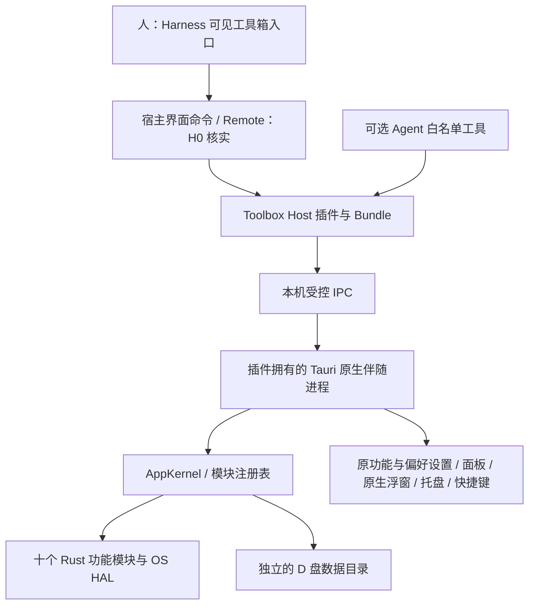

# YourAllIn1Helper → DeepSeek Harness 插件迁移计划

初版日期：2026-11-12；修订：2026-11-13，按用户澄清改为人用优先。已完成的 headless alpha 及测试见 [第二轮集成验收](INTEGRATION_R2.zh-CN.md)，下一阶段的具体门槛与快捷键清单见 [人用优先实施计划](HUMAN_FIRST_PLAN.zh-CN.md)。

工作区：`D:\Code\dsh-toolbox`。源码和环境事实见 [勘察基线](BASELINE.zh-CN.md)。

## 1. 迁移目标与首版范围

把现有工具箱变成可通过 Harness 安装、打开、配置和卸载的长期插件，主要服务使用者本人。优先保留原界面、成熟 Rust 模块、原生桌面操作与快捷键，再为确有价值的能力增加可选 Agent 接口。默认目标为 **Windows x64、本机运行的 Harness**；macOS 兼容作为后续阶段，云端 Harness 控制本机桌面不在首版范围。

用户最终应当能够：

- 无需开启聊天或请求模型，从 Harness 的可见工具箱入口进入原有“功能／偏好设置”，打开各功能面板。
- 延续原快捷键、自定义绑定和托盘操作，完成截图、贴图、注释、便笺、翻译、脚本、密码管理及使用时间查看等日常流程。
- 人用流程完成后，再按独立开关允许 Agent 创建指定便笺、转换选定图片等适合自动化的任务。
- 取消正在运行的任务；禁用模块后立即拒绝新操作；卸载后释放插件拥有的进程、快捷键、监听器及窗口。
- 在 D 盘完成开发、测试和打包，通过预构建包安装，无需使用者先安装 Rust。

**首个人用可试用版本（MVP）**先交付真实 Harness 入口、原生功能／偏好设置、便笺完整窗口流程、原快捷键管理与实际全局按键闭环，以及可靠的启停和卸载。随后恢复十个模块的日常界面、动作与快捷键，逐项验证功能对等。仅有 headless CRUD 或通过 Tool 调用不算人的功能已迁移。

`0.1.0-alpha.2` 已完成桥接、便笺存储、图片转换和 Agent 适配的技术基础；其验收结果保留，但不再称为整项迁移的人用 MVP。脚本、密码本、使用统计可以作为完整的人用功能交付，**不要求提供 Agent 工具**。

拟采用本地开发包名 `dsh-toolbox`；实际发布名及可用性在发布阶段确认。本计划不执行公开发布。

## 2. 关键架构决策

### 2.1 普通插件 + Bundle，复用 Rust 原生宿主

采用可安装的普通 Cordis 插件和 Bundle，不把长期功能建立在临时 `cordis_define/run` 包上。后者不提供所需的安装、版本交付和重启恢复基础。[指南：动态插件边界](https://github.com/moneka123/deepseek-harness-plugin-dev-guide/blob/f224099dce05f47c931d5e70d09ace9627607401/DYNAMIC-PLUGINS.md)

现有 `app-core`、`os-hal` 和十个 `mod-*` 是复用主体。先保留 Tauri 宿主及原生界面，增加受控桥接模式；只抽取实现接入所必需的公共装配与路由，不预先重写整套应用。原项目主控台、脚本事件、凭据注入、截图二进制通道等仍有宿主耦合，不能把“模块已经拆 crate”理解成“零修改可嵌入”。



Host 插件负责人的入口与原生运行实例、配置、生命周期，以及单独启用的 Agent 适配。原生进程负责原界面、业务执行和桌面资源。Harness Client 只承担宿主内入口与必要展示，不直接访问 Node、文件系统或本地 IPC。人用命令与模型可调用方法分别装配，不能因为某项功能可供人点击就把它注册进模型工具目录。

现有 headless exe 没有 Tauri 窗口、托盘和真实全局快捷键，不能替代桌面宿主。下一阶段先接回 Tauri/Vue 运行模式；一个 Profile/数据目录只有一个内核所有者，界面与已有适配复用该实例，不能再启动第二个进程争写数据库或抢相同快捷键。

### 2.2 原生伴随进程的第一条实现路径

Windows 继续使用 **当前用户限定的 Named Pipe**，承载版本化、带长度边界的 JSON 请求/响应及事件。目标 GUI 伴随进程需保留 Tauri 主事件循环，以支持窗口、系统回调和全局快捷键。headless 的管道/数据目录等参数已经实现；GUI 正式启动与模式选择参数需另行定义并验证，不能假定现有 headless exe 支持桌面模式。

- 由 Host 经目标 Harness 支持的子进程能力启动固定的随包 exe；核对策略后执行，不能假设普通 shell 沙箱允许所有桌面操作。
- 使用随机管道名、当前用户 ACL、拒绝远程客户端及启动实例握手；验证连接对应本次拥有的进程。不建立跨会话的通用“调用任意 IPC”服务。
- 一个运行实例拥有一个内核和一个数据目录；同一目录加独占锁。多个 Profile 的数据默认分开，争用桌面快捷键时明确报告冲突。
- 桥接启动模式默认不自动打开主控台、不启动原应用 updater，也不自动启用剪贴板采集或应用跟踪。模块按插件配置启用。
- 父进程退出、管道断开或心跳失联时进入停机流程；用 Job Object 或等效 Windows 机制兜底回收所属进程树。正常退出仍先保存并关闭资源。
- 不接管用户独立启动的旧工具箱进程，不终止其他应用。

headless release 的连接、握手、崩溃与关停已验证。H0/H1 还必须在真实 Tauri GUI 模式中验证同类生命周期与资源所有权，不能从 headless 成功推断窗口、托盘和快捷键也已接入。

不直接启用现有 `legacy_http.rs` 作为发布桥。它是旧开发通道，存在按字符串分发 IPC、手写 HTTP 读取等实现；迁移只复用业务路由思想，新的桥有独立的版本、消息上限、调用白名单与取消协议。

### 2.3 Harness 扩展边界

优先独立函数插件、现有工具/任务/配置扩展点和后置 Patch；不修改 Harness 核心、Agent Loop 或内置 Bundle。普通发布入口为 ESM JavaScript。`name`、`apply`、`inject`、`Config` 等导出形式以实际 Loader 核对结果为准。[指南：开发规则](https://github.com/moneka123/deepseek-harness-plugin-dev-guide/blob/f224099dce05f47c931d5e70d09ace9627607401/AGENTS.md)

首版必须有不经过模型的可见人用入口。立即核实目标 Harness 的外部 Client/菜单/命令装配能力；先从这个入口打开复用的 Tauri/Vue 功能与偏好界面、独立面板及原生窗口，保留原布局和操作习惯。完整内嵌页面仅在宿主能力支持且有必要时适配，不以重写全部前端作为恢复人用体验的前提。若入口扩展不支持，应明确记录阻碍；CLI 能启动或 Agent 能调用不能替代这项验收。

Host 与 Client 出现独立编译需求时拆包，共享协议保持浏览器可用。`window.__TAURI__`、Tauri 事件订阅、Win32 和凭据访问均留在各自适配器，不进入 Client bundle。[指南：扩展点参考](https://github.com/moneka123/deepseek-harness-plugin-dev-guide/blob/f224099dce05f47c931d5e70d09ace9627607401/REFERENCE.md)

## 3. 十个模块的迁移映射

以下为拟定迁移范围；“复用”表示代码基础存在，不代表新宿主下已验证。

| 模块 | 主要复用位置 | 人用迁移目标 | Agent 接口决定 | 优先工作 |
| --- | --- | --- | --- | --- |
| 便笺 `sticky_note` | 原模块、Vue 便笺窗口及 IPC | 新建、编辑、格式、置顶、关闭保存、重启恢复 | 已有存储接口保留，后续可选开放指定便笺操作 | 真实桌面窗口先验收 |
| 多媒体 `media_proc` | 原模块、多媒体面板及 IPC | 文件选择、批量、格式、进度、取消、产物打开与 FFmpeg | 图片转换等确定任务可选开放 | 恢复完整面板流程 |
| 截图/贴图 `screenshot` | 原遮罩、编辑器、贴图及二进制通道 | 默认热键、区域/长截图/GIF/OCR、编辑、复制、保存、贴图 | 后续单独评估，先保持人触发 | 原交互及多屏/DPI |
| 翻译 `translator` | 原模块、主面板、划词气泡 | 原快捷键、外部应用选区、划词、翻译设置 | 显式文本翻译可选；不自动开放监听 | 选区、焦点及凭据适配 |
| 屏幕注释 `screen_ink` | 原模块、画布、工具栏 | 热键开始/结束、穿透、绘制、导出 | 当前以人用为范围 | 原生透明窗口与清理 |
| 窗口置顶 `window_pin` | 原模块、拾取器及 OS HAL | 当前窗口置顶、准星选择、面板管理与恢复 | 当前以人用为范围 | 原热键与窗口状态 |
| 剪贴板 `clipboard` | 原模块、候选窗及面板 | 原热键、历史、搜索、固定、选择粘贴、焦点恢复 | 后续独立评估，当前不新增历史读取工具 | 采集开关与真实粘贴 |
| 使用统计 `app_usage` | 原模块、统计面板及 IPC | 用户开启后查看屏幕使用时间、汇总、设置 | **本轮保持人用，不注册 Agent 工具** | 原统计与启停体验 |
| 脚本 `script_runner` | 原模块、脚本面板、托盘及热键 | 人配置/运行脚本，参数、日志、取消、单脚本热键 | **本轮保持人用，不注册 Agent 工具** | 保留原执行工作流 |
| 密码本 `password_vault` | 原模块、密码本界面及认证流程 | 原面板热键、解锁、条目、OTP、锁定及迁移 | **本轮保持人用，不注册 Agent 工具** | 保留原认证与界面行为 |

截图权限与图片回传、剪贴板内容、窗口标题、翻译到外部服务等数据流需要明确的用户操作和产品说明。密码本先提供 UI 入口，不设计模型读取任意密码的工具。脚本迁移也不向模型直接暴露旧通用 IPC 路由或任意 Shell 字符串。

## 4. 人的交互、快捷键与可选 Agent 接口

### 4.1 人用交互与快捷键是首要验收项

以原 `docs/USER_GUIDE.md`、Vue 界面、`src-tauri/src/preferences.rs`、原生快捷键注册和各模块 ShortcutSpec 为对等基线。保留功能／偏好设置、独立面板、重复打开前置、关闭面板继续运行、托盘与明确退出、语言和主题。关闭聊天不停止工具箱；真正卸载或宿主退出时才按所有权停稳。

默认绑定、未绑定动作、用户覆盖、每个模块的打开面板绑定、单脚本热键与局部按键均逐项迁移。保留录入、Escape 放弃、Tab 导航、清除、恢复默认、冲突检测、注册失败回滚和重启持久化。不能静默换键、把全局快捷键降为网页内快捷键，或用 IPC 触发动作代替实际物理按键验收。详细清单见 [人用优先计划](HUMAN_FIRST_PLAN.zh-CN.md)。

### 4.2 独立授权的五模块工具（最新用户范围）

| 拟定工具名 | 输入概念 | 输出概念 |
| --- | --- | --- |
| 截图 | 明确显示器/区域 | 真实截图及模型可读取的受控图像产物 |
| 剪贴板 | 限量查询、条目ID或待写文本 | 同一历史文本与显式写入结果 |
| 屏幕注释 | 结构化笔画、会话操作、快照 | 同一原画布的状态及图像 |
| 使用时长 | 有界日期范围 | 同一统计库的概览、应用与小时聚合 |
| 便笺 | 搜索、指定ID读写/打开、预期版本 | 同一便笺库与原编辑窗口；版本冲突保留草稿 |

最新用户要求截图、剪贴板、屏幕注释、使用时长、便笺支持 Agent；功能启停与 Agent 授权两个独立开关，新旧配置授权默认关闭。其余五项明确不支持 Agent；便笺新增同内核受授权接口，新发布版本停用旧 headless 便笺/图片工具入口，历史 alpha 归档和测试证据保留。某模块没有 Tool 不影响人用迁移完成。实施见 [A2 后续计划](A2_NEXT_PHASE.zh-CN.md) 与 [契约](A2_CONTRACT.md)。

返回 JSON-safe 业务结果，错误通过宿主支持的错误契约传播，稳定区分取消、权限拒绝、模块禁用、缺少依赖、版本不匹配、文件冲突和执行失败。二进制图片/音视频不塞入巨型 JSON；由宿主支持的附件或产物接口返回，并单独限制大小、访问和保留期限。

### 4.3 受控桥协议与入口分离

请求至少携带协议版本、请求 ID、明确方法、参数、超时预算；响应带结果或结构化错误。另有取消、ready、进度、完成及停机消息。Host 调用身份和本机授权状态由可信适配层传递，不接受模型自行声明身份或批准状态。

Agent 通道仅允许五项白名单的已实现方法；模块支持、启用和授权在执行端逐次检查，撤回后旧 Tool 引用也拒绝。人用原生界面通过经过验证的界面命令入口使用模块，不能先绕到 LLM Tool 再执行。不能因请求来自管道绕过限制，也不能由参数自行声明“我是人”获得全部旧 IPC。

前台请求把 `exec.signal` 传播到桥、Rust 任务和外部程序；旧同步业务需要补取消点，不能只停止等待而让工作继续写文件。后台媒体任务接入宿主 Job 所有权，明确区分“取消此次等待”和“终止任务”。任务 ID、进度频率、并发上限和重复请求语义需有测试。

Agent 文件操作先经过 Harness 的文件/工作区策略，再向原生进程授予具体范围。人用界面保留文件选择器和原输出操作，不要求用户通过聊天逐次授权日常动作；使用该入口适用的真实用户授权。两条路径都处理链接、路径和覆盖语义，模块开关一致生效。FFmpeg/解释器使用参数数组；不确定写入结果不盲目重试。

### 4.4 原生与会话展示

首版展示每个功能的可用/启用/不支持/依赖缺失状态。启动失败要说明具体依赖或原生原因；缺 FFmpeg 不阻止便笺与图片功能启动。使用中文任务描述，错误提供可操作的下一步。

工具结果中被模型使用的事实通过宿主正常会话结果路径持久化。UI 卡片从可回放事件重建；插件私有数据库不等于会话日志。展示投影保持纯函数，页面通过受支持 Remote API 查询私有数据。对已过保留期的产物显示失效状态，不假定历史图片永久可访问。

## 5. 生命周期、配置与隔离

Host 的配置至少覆盖：`nativeExecutable`、`dataDir`、`artifactDir`、模块开关、超时、并发上限、产物保留、允许的文件根目录和外部程序路径。使用目标宿主支持的 Config Schema，启动前验证必填路径、跨字段约束及支持的桥版本。

运行时执行顺序：

1. 验证配置与二进制清单，取得数据目录锁，启动伴随进程。
2. 完成握手和探测后开放人的界面入口；独立启用的 Agent 适配另按白名单注册工具。未 ready 的操作明确等待或失败。
3. 进入卸载/重载：停止接受请求，取消或结束本插件拥有的任务。
4. 在一个有序异步清理流程中保存便笺、锁定密码本、还原置顶、关闭窗口、解除快捷键和监听器、关闭数据库。
5. 请求伴随进程退出并等待；超时才执行限定于本进程树的终止；最后释放 IPC、锁、订阅与临时产物。

以 `ctx.effect()` 绑定外部资源，显式等待异步工作停稳；不能假设多个 disposer 严格串行，也不能把移除 npm 包当作当前进程已经停机。重载失败的保留与恢复策略用实测定义，不承诺自动回滚。

默认每个开发/测试 Profile 独立数据目录，禁止双进程共享写入同一旧数据库。模块启用状态以原生内核为执行事实，Host/UI 同步展示；保存失败或启用失败不能显示成功。关键拒绝在真实执行路径落实，工具隐藏只用于发现和体验。

## 6. 工作区与 D 盘约束

### 6.1 目录约定

```text
D:\Code\dsh-toolbox\
├── README.md
├── docs\                         # 计划、基线、接口、测试/发布记录
│   └── references\               # 固定版本指南快照（已创建）
├── packages\
│   ├── dsh-toolbox\              # 首版 Host、工具与 Bundle
│   ├── dsh-toolbox-client\       # H0 核实入口后按需创建
│   └── contracts\                # 双端实际共享时再抽取
├── native\YourAllIn1Helper\      # 固定基线的原生源码副本
├── scripts\                      # 环境、构建、验收、打包脚本
├── vendor\harness\               # 仅在需要源码核对/构建时创建
├── build\rust\{target,intermediates}\
├── runtime\                      # 开发/验收 DSH_HOME、独立用户数据
├── artifacts\                    # 截图、媒体及验证证据
├── dist\                         # npm tgz、原生二进制、校验与清单
└── .tmp\                         # 本项目所有工具的临时目录
```

以上是目录约定，已创建的后端、源码、环境和产物见 README；Client 等未实施部分按需新增。原源码已以固定 Git commit 的跟踪文件导出到 `native`，排除 `.git`、`.cargo` 本地配置、`node_modules`、运行数据、旧输出和目录链接；不递归照搬 C 盘工作树，也不沿 junction 复制旧构建目录。

### 6.2 构建进程环境

已有项目级 PowerShell 环境脚本，只设置当前进程及子进程的环境，不改 Windows 全局设置；GUI 构建继续遵循同一约束：

| 设置/产物 | 约定 |
| --- | --- |
| CARGO_HOME / RUSTUP_HOME | 复用 `D:\Dev\Rust\cargo` 与 `D:\Dev\Rust\rustup` |
| Cargo target | `D:\Code\dsh-toolbox\build\rust\target` |
| Cargo build intermediates | `D:\Code\dsh-toolbox\build\rust\intermediates`，覆盖现有全局 `build-dir`；后端已验证，GUI 构建继续检查 |
| npm / pnpm 缓存 | 复用 `D:\cache\Node` 下的现有目录；各 pnpm 主版本确认实际 store 路径 |
| 新 pnpm 版本 | 实际 Harness 如要求 11.7.0，在 D 盘项目工具目录或现有版本管理区隔离使用，保留旧项目的 pnpm 10 |
| TEMP / TMP / TMPDIR | `D:\Code\dsh-toolbox\.tmp`，并传给全部构建、测试、打包子进程 |
| DSH_HOME | 开发与安装验收分别指向 `runtime\dsh-dev`、`runtime\dsh-acceptance` |
| 原生数据目录 | 显式传入 `runtime\toolbox\<profile>`；新增正式配置接口，不把 GUI 测试变量当成产品接口 |
| 前端输出、WebView 用户数据、下载 staging | 显式定位在工作区内；按实际宿主配置逐项核对 |
| 发布产物 | `dist\`；包内路径相对解析，不包含本机 `D:\...` 绝对路径 |

已安装 Node 位于 C 盘，可继续只读使用；系统 SDK、WebView2 和操作系统管理的凭据可能仍有系统目录活动。项目主动生成的构建、测试、缓存和包应定位到 D 盘，不声称整个操作系统会零写入 C 盘。

不能复制原 `.cargo/config.toml`：它会让新项目输出混入旧工具箱缓存。环境脚本同时检查 Cargo 全局 `build-dir`、前端 `outDir`、Tauri 输出和任何重解析点目标，确认所有项目产物落在本工作区。不要设置 `USERPROFILE`、`APPDATA` 或 `LOCALAPPDATA` 来强行重定位整个系统。

`D:\cache` 只作为共享缓存和既有工具来源，不在其中放本项目发布包，不整体清理。原项目、旧安装数据、现有 `.dsh` 及其他会话目录均不修改。

## 7. 数据迁移与兼容

人用开发先使用空白隔离数据，不自动打开原数据库。人的替代版本验收包含自定义快捷键、设置和业务数据的显式导入，不再等 Agent 接口齐全。迁移流程：

1. 探测旧数据位置并由用户选择。默认 Tauri 数据在用户应用目录，但实际可能有自定义路径；不要把 C 盘源码目录当作用户数据库。
2. 正常退出旧应用以冲刷窗口数据；若支持在线备份，使用 SQLite backup 一致性接口，不能只复制处于 WAL 状态的 `app.db`。
3. 在工作区导入 staging 创建数据库、配置及关联文件的备份与清单，记录源版本、Schema、文件哈希和条目数。不输出私人内容。
4. 在目标副本执行原迁移链，检查便笺、剪贴板文件、脚本、媒体记录和窗口配置的引用；按记录来源规则处理已不存在的绝对路径。
5. 在新环境验证重启、查询、编辑及模块开关，再启用正式目标目录；失败时保留原件和错误报告。

密码本单列验收：密文数据库、设备密钥、`vault-hello` 文件及操作系统密钥标识可能分处不同位置；Windows Hello 不可导出密钥不能靠复制数据库迁移。先核对身份/slot/路径依赖，保留主密码恢复与重新绑定流程；不降低认证方式，也不让模型读取密钥。翻译 API Key 同样先验证凭据后端与标识，不能假定复制配置就能继续使用。

初期保留旧应用标识相关的凭据访问适配，但数据目录独立；任何标识变更须有迁移说明。导入后的数据版本不兼容旧版时，回退到导入前备份和旧应用，而非强行降级新数据库。卸载插件保留用户数据，删除数据必须是独立的明确操作。

## 8. 分阶段执行与交付门槛

原 M0–M6 的“工具先行”排期停止作为后续实施顺序。已有 alpha 记录保留，新的顺序按下表执行；在可见入口、Tauri GUI 装配和快捷键基线核对完成前，不沿用旧工期估算。

| 阶段 | 时间 | 具体工作与交付物 | 进入下一阶段的门槛 |
| --- | --- | --- | --- |
| 基础 alpha（已完成） | 历史记录 | 原生桥、无窗口便笺、图片转换、工具适配与包验收 | 不代表原桌面体验已迁移 |
| H0：人用基线与入口 | 待核实后估算 | 功能/局部键/全局键清单、当前 Client 入口验证、GUI 资源及单实例设计 | 从真实 Harness 可见入口打开原生界面，无模型调用 |
| H1：首个人用闭环 | H0 后重估 | 原功能/偏好界面、便笺窗口、托盘、快捷键管理与保存恢复 | 点击、输入、实际按键、关闭/重开/重启、卸载均验证；不依赖 Agent |
| H2：原功能与快捷键对等 | 按模块拆分 | 十模块逐项恢复；截图/贴图/注释/置顶/翻译/剪贴板/媒体，以及人用脚本、密码本、统计 | 每模块按原日常流程验收，热键原样或显式报告冲突；没有 Tool 也可完成 |
| H3：个人配置、数据与替代验收 | 随模块推进 | 快捷键覆盖、主题语言、设置、业务数据和凭据的导入/回退 | 保留原件；用户配置不被默认值覆盖；达到约定对等后才建议替代旧应用 |
| H4/A2：五模块 Agent | 先权限基础与便笺，再图像/画布接通 | 截图、剪贴板、注释、使用时长、便笺；其余五项不支持 | 默认无授权、原生拒绝绕过、便笺不丢草稿、真实数据共享、撤回及时、人用不受影响 |
| H5：发布候选 | 人用主线就绪后 | GUI/快捷键/生命周期、包内容、兼容性、许可证和升级卸载 | 从发布物完成真实人用流程；Agent 可选项不阻塞纯人用发布 |

H2/H3 按已验证模块增量交付。高级截图模式不能默认为已迁移；macOS 和远程场景保持独立待办。H4 的新接口不会抢占尚未完成的人用工作。

实施中维护逐项功能对等表，特别列出滚动截图、GIF、贴图操作、翻译服务、OTP、快捷键和设置。Windows 旧版功能需全部标明已迁移、保留原生入口、明确延期或不支持及其原因；只有完成约定的功能对等和真实数据验证，才建议替代旧应用。上述发布候选估时不等同于全功能对等的工期。

## 9. 测试与验收

实施时记录目录、输入、版本、结果及证据。已完成的 alpha 测试见历史验收；下列人用/GUI/快捷键门槛尚未完成，不能由 92 项 Node 和 43 项 Rust 的技术回归代替。

| 层级 | 验证内容 | 可观察的通过标准 |
| --- | --- | --- |
| P0：加载与交付 | 类型检查、ESM 构建、普通 Node 加载、实际 Loader、tarball 内容 | JS/exports/Patch/原生 exe 齐全；不依赖未发布 TS 或本机绝对路径；Fiber 进入预期状态 |
| P0：执行边界 | 未启用模块、越界路径、未经允许覆盖、非法桥方法、无效二进制/协议 | 操作在执行端被拒绝；没有越权写入、启动或采集 |
| P0：人用主流程 | Harness 可见入口、原界面、完整便笺/模块操作 | 不请求模型；实际点击输入和窗口操作可用；最后编辑保存并重启恢复 |
| P0：快捷键对等 | 默认键、未绑定、自定义、局部键、冲突和回滚 | 全局键在其他应用前台时实际生效；原覆盖不丢失；失败保持旧设置；无静默换键 |
| P1：生命周期 | 连续 20 次启停/重载、取消、崩溃、Job kill | 无重复工具/监听器/快捷键；所属任务与进程树停稳；数据库和文件锁释放 |
| P1：协议与错误 | 分包/粘包、消息过大、重复 ID、断线、超时、重连 | 边界错误明确；副作用不盲目重放；未提交取消与已提交成功/未知结果区分明确 |
| P1：数据 | 副本导入、迁移失败、写入中断、并发打开、备份回退 | 拒绝双实例写；源数据保持；目标一致性/文件引用检查通过 |
| P1：界面 | Harness 人用入口、原生窗口、焦点、退出冲刷 | 实际点击和输入可用；便笺最后编辑已保存；采用 Client 时另验证实际加载 |
| P2：平台与性能 | 多屏混合 DPI、锁屏/睡眠、Windows Hello、窗口关闭、长媒体任务 | 真机结果及限制逐项记录；mock 或烟测不能替代硬件手势与全局按键验证 |

H0/H1 记录相对原工具箱的启动时间、空闲 CPU/内存、面板响应和全局键响应；迁移目标是避免明显劣化，性能门槛按同机测量制定。默认不预加载全部原生窗口，不启动未启用模块的轮询。

复用原有 Rust 与前端测试，但只在 D 盘副本执行；新加桥、授权、取消、数据导入和发布组合测试。原项目 README 提供的测试命令可作为初始清单，实际存在的脚本与适用范围核实后再写入验收报告。

## 10. 构建、打包、安装与回退

交付优先为 **预构建 npm tarball + Windows x64 原生伴随二进制**。人用版本把 GUI 二进制和必要 Tauri/Vue 资源纳入发布物；H5 实测体积与依赖后再决定是否拆平台包。要求用户无需 Rust、无需从插件安装脚本临时下载或编译原生程序；WebView2、FFmpeg 等外部要求另列。

Cordis 和宿主服务定义使用实际兼容的 peer，避免打入第二份框架；普通运行依赖、桥协议和原生资源由插件完整声明。Bundle 元数据、Patch 和 exports 全部进入 tarball；Patch 使用稳定命名空间 ID，发布时引用安装包入口。配置覆盖按目标版本规则核对，不假定深度合并。[指南：打包安装](https://github.com/moneka123/deepseek-harness-plugin-dev-guide/blob/f224099dce05f47c931d5e70d09ace9627607401/INSTALLATION.md)

实施时按当前 CLI `--help` 核验后生成确切命令，不照抄指南中的不存在的源码目录。验证流程为：

1. 在本工作区构建 Host；需要 Client 时分别构建；编译原生 release 与所需前端资源。
2. 打包到 `dist`，查看实际文件清单、大小、许可证、入口、二进制平台和 SHA-256。若当前 pnpm 不支持指南示例的 dry-run 参数，使用真实打包后的归档检查。
3. 将 `DSH_HOME` 指向 `runtime\dsh-acceptance`，通过当前 CLI 安装 tgz。显式装配目标 App 的 base/web-app 及插件，不能认为任意新 Profile 自带 Web App。
4. `--dump-config` 审计最终 Entry、Bundle 顺序和完整配置；随后真正启动 Profile 并执行功能。dump 成功不代表运行成功。
5. 用更新后的 tgz 演练版本升级、桥版本不匹配及失败恢复；变更前保存 Profile 清单、锁文件、配置与业务备份，停稳旧实例后再切换。
6. 移除包及相应 Bundle/用户覆盖，停止或重载实际运行时；重新审计并启动，确认贡献和资源消失，用户数据按约定保留。

发布清单记录插件源码版本、原生源基线、Harness revision/版本、Node/pnpm/Rust 版本、lockfile、资源清单、哈希、测试记录和未测项目。原应用自动更新不进入桥接模式；插件与伴随二进制按同一发布清单更新，避免协议错配。

## 11. 桌面阶段仍需闭合的事项

| 未知项 | 解决阶段 | 决策影响 |
| --- | --- | --- |
| 已安装宿主基线 | 已核实：E 盘 Harness 0.2.2-rc.1 | 后端已验证；GUI/Client 仍以实际安装版本为依据 |
| 当前宿主可见人用入口、外部 Client/Remote 装配是否支持 | H0，立即核实 | 是人的插件入口前置项；CLI/Agent 成功不能替代 |
| GUI 模式正式启动参数、管道与桌面资源的共同所有权 | H0/H1 | 不启动两套内核争写数据或抢快捷键 |
| Tauri/WebView2 运行时、资源和用户数据目录 | H0/H1、H5 | GUI 发布物可用且构建/验收保持 D 盘隔离 |
| 原快捷键覆盖、局部键、配置导入和冲突回滚 | H0–H3 | 保留操作习惯，真实按键和重启验证 |
| 旧业务数据目录、Hello slot/身份及凭据引用 | H3 | 导入策略和本人认证需求 |
| FFmpeg/解释器的人用配置与许可证清单 | H2/H5 | 保留原操作与依赖提示，决定分发范围 |

这些未知项不阻碍本次迁移规划交付；实施时先关闭对应前置项再依赖其行为。任何阶段都以真实源码、构建入口和外部结果为依据，不把指南的版本说明写成尚未核实的本机保证。
